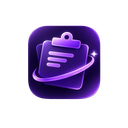
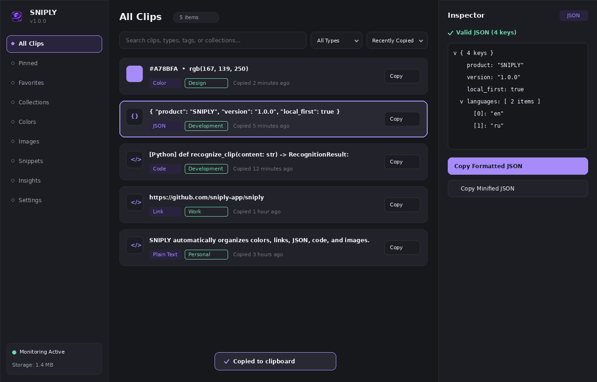
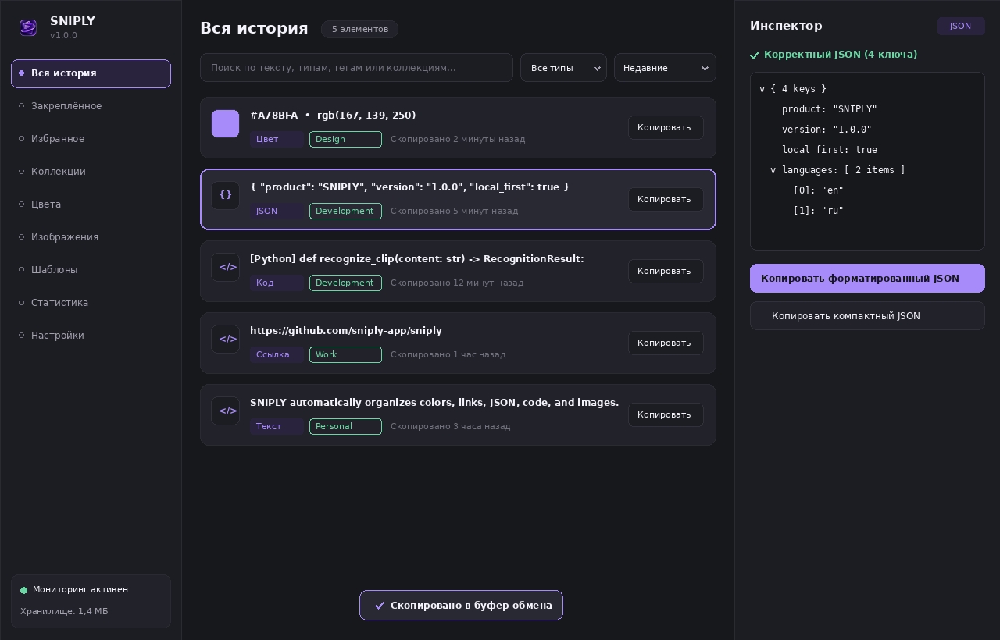
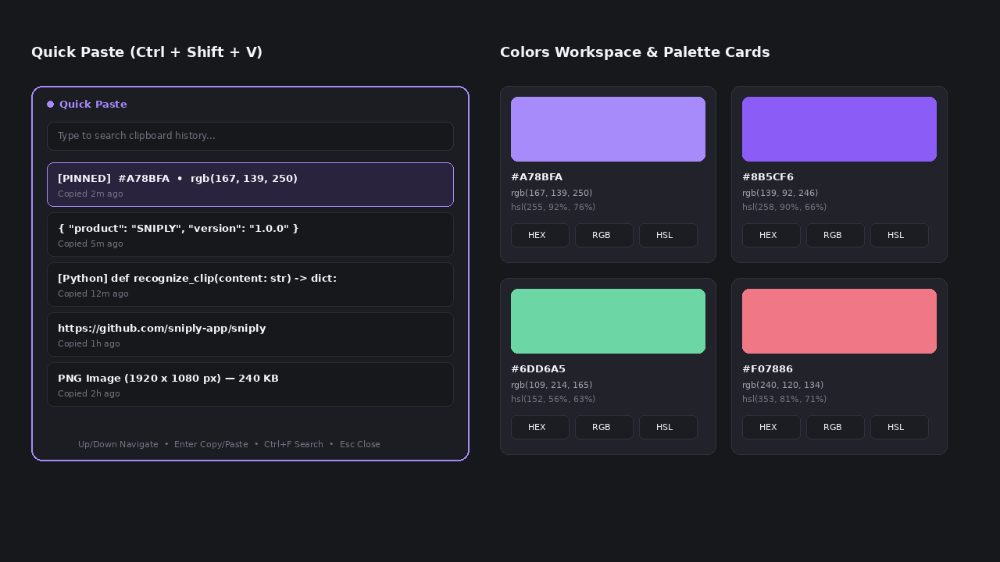

<div align="center">
  
  <h1>SNIPLY</h1>
  <p><strong>Your clipboard. Reimagined.</strong></p>
  <p>
    An intelligent, local-first Windows 10 &amp; Windows 11 clipboard manager built with Python, PySide6, and SQLite.<br/>
    Recognizes HEX/RGB colors, JSON payloads, URLs, code snippets, emails, and high-resolution images — 100% offline.
  </p>
  <p>
    
    
    
    
    
  </p>
</div>

## 1. Product Introduction

Traditional clipboard managers simply store a flat list of copied text. **SNIPLY** understands what you copy:

- **HEX & RGB Colors** (`#A78BFA`, `rgb(167, 139, 250)`, `rgba(...)`) become interactive visual color cards with instant conversions between HEX, RGB, HSL, and Alpha.
- **JSON Objects & Arrays** become validated, collapsible structure trees with one-click pretty formatting and minification.
- **Source Code Fragments** across Python, JavaScript, TypeScript, HTML, CSS, SQL, Bash, PowerShell, Java, and C++ are automatically identified and rendered with [Pygments](https://pygments.org/) syntax highlighting.
- **HTTP/HTTPS Links & Emails** display domain metadata and quick actions without ever making background network requests.
- **Copied Images & Screenshots** are stored locally with cached thumbnails, dimension/file-size metadata, and instant clipboard restoration.

SNIPLY operates **100% offline** with zero telemetry, zero cloud sync, and no external API calls.

## 2. Main Application Interface

### English Interface (`en`)


### Russian Interface (`ru` — Русский интерфейс)


## 3. Feature Overview

| Capability | Details |
| :--- | :--- |
| **Smart Recognition Engine** | Modular pipeline (`recognizers/`) automatically classifying Colors, URLs, JSON, Code (10+ languages), Emails, Images, and Plain Text. |
| **Quick Paste (`Ctrl+Shift+V`)** | Compact 600 × 480 floating launcher with instant search, keyboard navigation (`↑`/`↓`/`Enter`/`Esc`/`Ctrl+F`), and optional auto-paste into the previously focused window. |
| **Deduplication & Pin Protection** | Stable SHA-256 text hashing and perceptual + pixel-verified image hashing merge duplicate copies, increment usage counts, and promote items to the top while protecting pinned and favorite entries. |
| **Collections & Snippets Library** | Organize clips into color-coded collections (*Design*, *Development*, *Work*, *Personal*, *Prompts*) and maintain a separate library of reusable templates and snippets. |
| **Colors & Images Workspaces** | Dedicated visual grid for copied images with LRU thumbnail caching (`core/image_manager.py`) and a designer palette workspace with JSON/CSS palette export. |
| **Clipboard Insights** | Real-time local analytics computed directly from SQLite records, featuring a 7-day activity chart, content distribution, and top-used clips. |
| **First-Class Bilingual UI (`en` & `ru`)** | Complete English and Russian translations (280+ keys) with immediate live switching, Russian CLDR pluralization (`1 элемент`, `2 элемента`, `5 элементов`), and Windows locale detection. |

## 4. Quick Paste & Colors Workspace Preview



## 5. Requirements

- **Operating System**: Windows 10 or Windows 11 (64-bit) recommended for native Win32 global hotkeys (`RegisterHotKey`) and foreground process detection.
- **Python**: [Python 3.11+](https://www.python.org/downloads/) (when running from source or building).
- **Dependencies**:
  - [PySide6](https://pypi.org/project/PySide6/) (`>=6.6.0`) — Desktop UI, Qt Widgets, QSS styling, and system tray.
  - [Pillow](https://pypi.org/project/pillow/) (`>=10.2.0`) — Image processing and thumbnail caching.
  - [Pygments](https://pypi.org/project/Pygments/) (`>=2.17.0`) — Code syntax highlighting.
  - [pywin32](https://pypi.org/project/pywin32/) (`>=306` on Windows) / `ctypes` — Windows integration.
  - [pytest](https://pypi.org/project/pytest/) (`>=8.0.0`) — Automated testing.
  - [PyInstaller](https://pypi.org/project/pyinstaller/) (`>=6.4.0`) — Windows executable packaging.

## 6. Installation & Running from Source

```bash
# 1. Clone the repository
git clone https://github.com/kemorovv/SNIPLY.git
cd sniply

# 2. Create and activate a virtual environment
python -m venv .venv
.venv\Scripts\activate

# 3. Install dependencies
pip install -r requirements.txt

# 4. Launch SNIPLY
python main.py
```

## 7. Development Setup & Automated Testing

Regenerate icons, multi-size `.ico` files, and translation dictionaries at any time:

```bash
python scripts/generate_assets.py
python scripts/generate_translations.py
```

Run the full automated test suite (29 tests covering SQLite migrations, 10,000-entry query performance, recognition, deduplication, retention, privacy, clipboard restoration, and EN/RU localization):

```bash
pytest -v
# Or with standard library unittest:
python -m unittest discover -s tests -v
```

## 8. Building the Distributable Windows Executable & Installer

SNIPLY includes a repeatable build script (`scripts/build_windows.py`), a PyInstaller spec (`installer/sniply.spec`), and an [Inno Setup](https://jrsoftware.org/isinfo.php) installer script (`installer/sniply_setup.iss`).

On a 64-bit Windows 10/11 machine:

```bash
python scripts/build_windows.py
```

This pipeline:
1. Regenerates all `.ico`, `.png`, `.svg`, and `en.json`/`ru.json` assets.
2. Executes the automated test suite and halts on any failure.
3. Invokes `pyinstaller --noconfirm --clean installer/sniply.spec` to produce `dist/SNIPLY/SNIPLY.exe`.
4. Packages a portable archive at `dist/SNIPLY_v1.0.0_Windows_x64_Portable.zip`.
5. Compiles `dist/installer/SNIPLY_Setup_v1.0.0.exe` if Inno Setup (`ISCC.exe`) is installed.

## 9. Privacy & Security Architecture

- **100% Offline & Local-First**: All data is stored inside `%LOCALAPPDATA%\SNIPLY\sniply.db` and `%LOCALAPPDATA%\SNIPLY\images\`.
- **Explicit First-Launch Consent**: Clipboard monitoring does not start until the user completes the first-launch onboarding consent screen.
- **Excluded Applications**: Foreground process detection via `GetForegroundWindow` and `QueryFullProcessImageNameW` automatically ignores copies made inside excluded executables (`1Password.exe`, `KeePassXC.exe`, `Bitwarden.exe`, `Dashlane.exe`, etc.).
- **Conservative Secret Filtering**: Detects and skips obvious PEM private keys, OpenAI/GitHub/AWS secret tokens, JWTs, and explicit `password = ...` assignments without ever logging clipboard text.
- **Parameterized SQL**: Every SQLite query uses `?` parameter binding with WAL journaling and foreign-key enforcement.

## 10. Project Structure

```text
SNIPLY/
├── main.py                     # Application entry point
├── requirements.txt            # Production and packaging dependencies
├── pyproject.toml              # Project metadata and pytest configuration
├── README.md                   # Documentation
├── LICENSE                     # MIT License
├── CHANGELOG.md                # Release history
├── CONTRIBUTING.md             # Developer and localization guide
├── RELEASE_CHECKLIST.md        # Pre-release verification checklist
├── .gitignore                  # Protects user databases, logs, and build artifacts
├── app/
│   ├── __init__.py
│   ├── application.py          # Single-instance lock, theme loader, startup flow
│   ├── constants.py            # Palette tokens, dimensions, defaults, demo items
│   └── paths.py                # %LOCALAPPDATA%\SNIPLY and PyInstaller path resolver
├── core/
│   ├── __init__.py
│   ├── clipboard_adapter.py    # QtClipboardAdapter & InMemoryClipboardAdapter
│   ├── clipboard_monitor.py    # Event-driven clipboard listener
│   ├── clipboard_manager.py    # Central coordinator for capture & restoration
│   ├── recognition_engine.py   # Modular content recognition pipeline
│   ├── duplicate_detector.py   # SHA-256 text & perceptual+byte image hashing
│   ├── image_manager.py        # Pillow thumbnail generation & LRU memory cache
│   ├── database.py             # Thread-safe SQLite connection & schema migrations
│   ├── storage.py              # CRUD, Unicode search, tags, stats, backup, export
│   ├── privacy.py              # Foreground process check & secret pattern filter
│   ├── retention.py            # Age & count cleanup protecting pinned/favorites
│   ├── shortcut_manager.py     # Win32 RegisterHotKey & shortcut conflict validator
│   ├── window_manager.py       # Foreground focus tracking & Windows Run registry
│   ├── i18n.py                 # English/Russian localization & CLDR pluralization
│   └── logger.py               # Rotating file logger with privacy redaction filter
├── recognizers/
│   ├── base.py
│   ├── color.py                # HEX (#RGB..#RRGGBBAA) & RGB/RGBA -> HSL
│   ├── url.py                  # Offline HTTP/HTTPS URL parser
│   ├── json_recognizer.py      # JSON validation, pretty print, minification
│   ├── code.py                 # 10-language detector + Pygments HTML highlighter
│   ├── email.py                # Standalone email recognizer
│   └── text.py                 # Plain text word/char/line & reading time metrics
├── models/
│   ├── clip.py
│   ├── collection.py
│   ├── snippet.py
│   └── settings.py
├── ui/
│   ├── main_window.py
│   ├── onboarding.py           # 6-screen first-launch wizard
│   ├── quick_paste.py          # Compact 600x480 floating Quick Paste window
│   ├── sidebar.py              # Collapsible navigation + privacy/storage footer
│   ├── inspector.py            # Adaptive right-side detail inspector
│   ├── history_view.py         # All Clips, Pinned, and Favorites views
│   ├── collections_view.py     # Collection manager & browser
│   ├── snippets_view.py        # Reusable Snippets library
│   ├── images_view.py          # Responsive thumbnail grid
│   ├── colors_view.py          # Designer color cards & palette exporter
│   ├── insights_view.py        # Local SQLite statistics & 7-day bar chart
│   ├── settings_view.py        # 6-tab settings with immediate EN/RU switching
│   ├── system_tray.py          # System tray icon & localized menu
│   └── widgets/
│       ├── clip_card.py
│       ├── color_card.py
│       ├── image_card.py
│       ├── toast.py
│       ├── empty_state.py
│       └── demo_banner.py
├── resources/
│   ├── icons/                  # 75 cohesive SVG icons (default, active, light)
│   ├── logo/                   # Multi-size PNGs and Windows sniply.ico
│   ├── styles/                 # dark.qss and light.qss stylesheets
│   ├── translations/           # en.json and ru.json (280+ keys each)
│   └── screenshots/            # Interface previews
├── tests/                      # 29 automated unit & integration tests
├── scripts/
│   ├── generate_assets.py
│   ├── generate_translations.py
│   └── build_windows.py
└── installer/
    ├── sniply.spec             # PyInstaller configuration
    └── sniply_setup.iss        # Inno Setup Windows installer script
```

## 11. Product Roadmap

- **v0.1 — Core (Completed)**: Main window, dark/light QSS design system, event-driven clipboard monitoring, SQLite persistence, search, pinning, favorites, system tray.
- **v0.2 — Productivity (Completed)**: Quick Paste (`Ctrl+Shift+V`), global shortcuts, user collections, custom context menus, reusable Snippets library.
- **v0.3 — Intelligence (Completed)**: HEX/RGB color recognition, URL recognition, JSON validation & tree view, Pygments code recognition, email recognition, image thumbnails.
- **v1.0 — Public Release (Completed)**: Complete Settings, English & Russian localization (`en`/`ru`), privacy & app exclusions, retention cleanup, Insights analytics, 6-step onboarding, automated test suite, PyInstaller & Inno Setup packaging.

## 12. Known Limitations

- **Elevated (Administrator) Windows Processes**: When SNIPLY runs with standard user privileges on Windows, Windows UIPI (User Interface Privilege Isolation) prevents non-elevated applications from sending simulated `Ctrl+V` keystrokes into elevated Administrator windows. Even in those cases, Quick Paste still restores the selected item to the Windows clipboard so pressing `Ctrl+V` manually works immediately.
- **Heuristic Secret Detection**: Conservative regular expressions in `core/privacy.py` filter obvious API tokens, private keys, and password labels, but no pattern matcher can identify every arbitrary secret string. Users should keep their password managers in the Excluded Applications list.
- **Rich Text Formats**: SNIPLY preserves plain text, HTML (`text/html`), and raster images (`PNG`/`BMP`/`JPEG`), but does not store proprietary binary OLE/RTF streams or file-drop handle lists in v1.0.

## 13. License

Released under the [MIT License](LICENSE).
